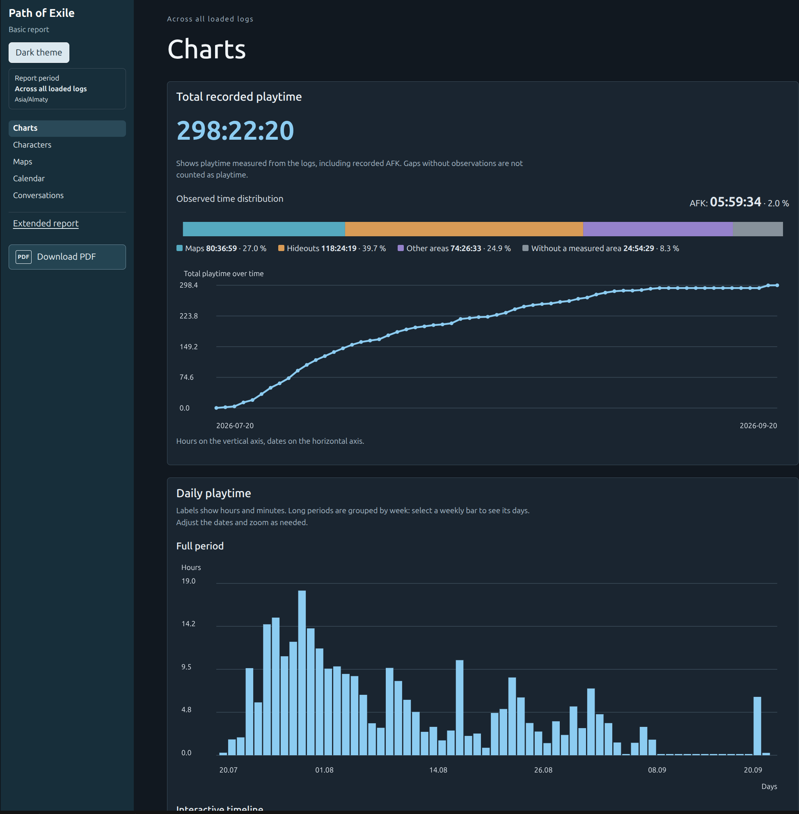
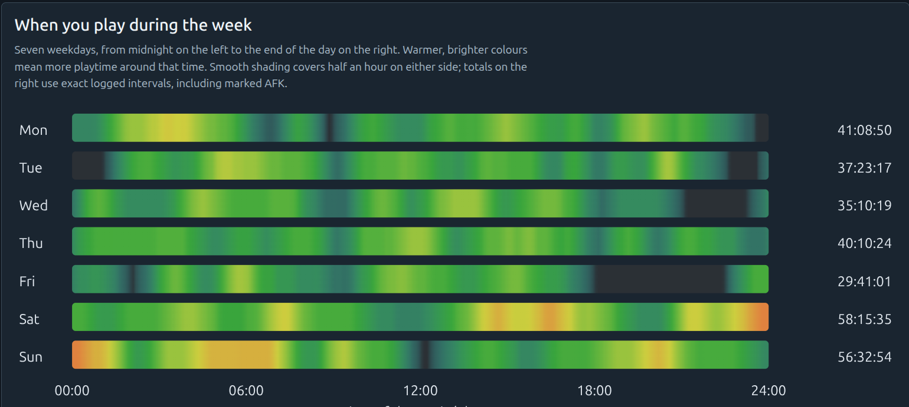

# PoE Log Report

A local Path of Exile 1 log analyzer. Generates basic and extended HTML/PDF
reports covering playtime, characters, maps, a calendar, conversations, and analytics.
Reports default to English; Russian can be selected in the interface.
Each selected report type automatically includes a PDF.


## Downloads

Download the portable **v0.1.6** packages from
[GitHub Releases](https://github.com/baev-os/poe-log-report/releases/tag/v0.1.6):

- [Windows x64 (.zip)](https://github.com/baev-os/poe-log-report/releases/download/v0.1.6/poe-log-report-0.1.6-windows-x64.zip)
- [Linux x86_64 (.tar.gz)](https://github.com/baev-os/poe-log-report/releases/download/v0.1.6/poe-log-report-0.1.6-linux-x86_64.tar.gz)
- [SHA-256 checksums](https://github.com/baev-os/poe-log-report/releases/download/v0.1.6/SHA256SUMS)

The repository is currently private; downloads require access to the repository.
Extract the complete archive into a writable folder, keeping the launcher beside
`app/`. On Windows, start `poe-log-analyze.cmd`; on Linux, run `./poe-log-analyze`.
Python installation is not required for these packages.

The release workflow validates native builds and relocated English/Russian
self-tests on Windows Server 2022 x64 and Ubuntu 24.04 x86_64. Linux also runs
in a clean desktop runtime without a separately installed Python. Version-specific
results are recorded in the release notes. Windows 10/11 manual acceptance remains
outstanding.

Build and release workflows create a **draft** for review; the maintainer
publishes it separately. See the
[release process](docs/releasing.md) and [readiness record](docs/public-readiness.md).

## Report examples

The basic report shows recorded playtime, time spent in different areas,
and cumulative and daily activity.



The weekly heatmap shows when you play across weekdays and hours.



## Run from source

Requires Python 3.14 and Tkinter/Tcl/Tk.

Linux:

```bash
python3.14 -m venv .venv
.venv/bin/python -m pip install -r requirements-desktop.txt
.venv/bin/python scripts/poe_desktop.py
```

Windows PowerShell:

```powershell
py -3.14 -m venv .venv
.\.venv\Scripts\python.exe -m pip install -r requirements-desktop.txt
.\.venv\Scripts\python.exe scripts/poe_desktop.py
```

Add logs, check the time zone, select report types, and start the analysis.
The default log time zone is `Europe/London` (GMT in winter, BST in summer),
in both the interface and CLI. Select the time zone used by your input logs.
Results are saved in `report/`; open `index.html` to view them.
A successful analysis replaces the previous report. Errors and cancellation preserve it.
Logs, reports, the environment, and local settings are excluded from Git.
Reports can contain conversations, character names, network addresses, and local
paths from the input. Review a report before sharing it; use synthetic logs for
issues and screenshots. See [security reporting](SECURITY.md).

CLI: `python -m poe_log_analyze --help` and
`python -m poe_log_analyze.report --help` with `PYTHONPATH=src`.

## Build and checks

Install `requirements-build.txt`, then run `./build.sh` on Linux
or `.\build.ps1` on Windows with MSVC x64. The distribution is created in `build/`.
Portable packages must include the complete application directory, including
`app/`, resources, libraries, and licenses. Copying only the executable will not work.
To check the source, install `requirements-dev.txt`:
[check commands](tests/README.md).

For a Linux release from a clean version tag, run
`./scripts/build_linux.sh --release-tag v0.1.6` with Docker installed.
The [release process](docs/releasing.md) explains the pinned build environment,
archive verification, and clean-system checks.

See [desktop usage and packaging](docs/desktop.md) and the [changelog](CHANGELOG.md).

The code is licensed under [MIT](LICENSE). Library licenses and game resource terms
are listed in [THIRD_PARTY_NOTICES.md](THIRD_PARTY_NOTICES.md).
Path of Exile materials belong to Grinding Gear Games and are included in good
faith for this noncommercial fan project. GGG retains its rights; affected
materials will be removed or replaced on its request. See the
[game-material policy](licenses/GAME_DATA.md).
This project is not affiliated with or endorsed by Grinding Gear Games.
