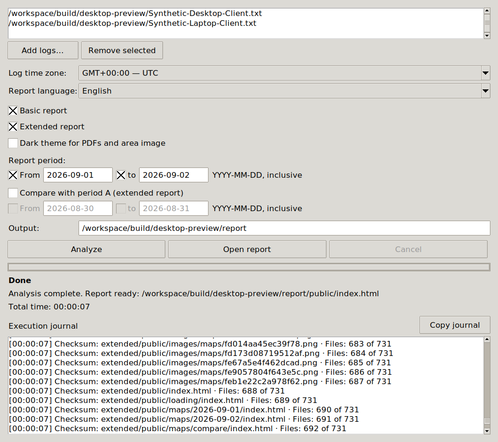

# PoE Log Report

A local Path of Exile 1 log analyzer. Generates basic and extended HTML/PDF
reports covering playtime, characters, maps, a calendar, conversations, and analytics.
Reports default to English; Russian can be selected in the interface.
Each selected report type automatically includes a PDF.



## Downloads

Portable v0.1.4 archives have passed native build and relocated English/Russian
self-tests on Windows Server 2022 x64 and Ubuntu 24.04 x86_64. Linux also passed
in a clean desktop runtime without a separately installed Python. Windows 10/11
manual acceptance remains outstanding.

There are no published binary downloads yet. Build and release workflows create
a **draft** for review; they do not publish it automatically. See the
[release process](docs/releasing.md) and [readiness record](docs/public-readiness.md).
Published downloads will appear on the
[GitHub Releases page](https://github.com/baev-os/poe-log-report/releases).

## Run from source

Requires Python 3.14 and Tkinter/Tcl/Tk.

Linux:

```bash
python3.14 -m venv .venv
.venv/bin/python -m pip install -r requirements-desktop.txt
.venv/bin/python scripts/poe_desktop.py
```

Windows PowerShell:

```powershell
py -3.14 -m venv .venv
.\.venv\Scripts\python.exe -m pip install -r requirements-desktop.txt
.\.venv\Scripts\python.exe scripts/poe_desktop.py
```

Add logs, check the time zone, select report types, and start the analysis.
Results are saved in `report/`; open `index.html` to view them.
A successful analysis replaces the previous report. Errors and cancellation preserve it.
Logs, reports, the environment, and local settings are excluded from Git.
Reports can contain conversations, character names, network addresses, and local
paths from the input. Review a report before sharing it; use synthetic logs for
issues and screenshots. See [security reporting](SECURITY.md).

CLI: `python -m poe_log_analyze --help` and
`python -m poe_log_analyze.report --help` with `PYTHONPATH=src`.

## Build and checks

Install `requirements-build.txt`, then run `./build.sh` on Linux
or `.\build.ps1` on Windows with MSVC x64. The distribution is created in `build/`.
Portable packages must include the complete application directory, including
`app/`, resources, libraries, and licenses. Copying only the executable will not work.
To check the source, install `requirements-dev.txt`:
[check commands](tests/README.md).

For a Linux release from a clean version tag, run
`./scripts/build_linux.sh --release-tag v0.1.4` with Docker installed.
The [release process](docs/releasing.md) explains the pinned build environment,
archive verification, and clean-system checks.

See [desktop usage and packaging](docs/desktop.md) and the [changelog](CHANGELOG.md).

The code is licensed under [MIT](LICENSE). Library licenses and game resource terms
are listed in [THIRD_PARTY_NOTICES.md](THIRD_PARTY_NOTICES.md).
This project is not affiliated with or endorsed by Grinding Gear Games.
